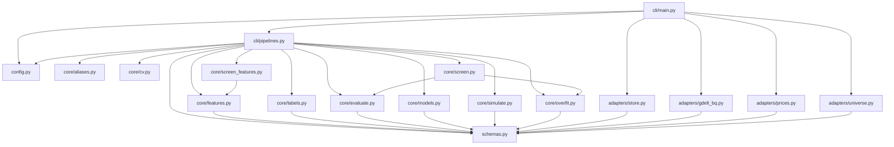
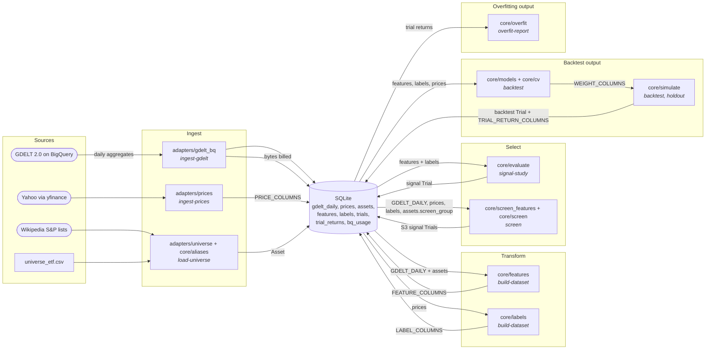

# Components — cli

## Stage view

| Output | Takes | Needs | Produces | Acted on by |
|---|---|---|---|---|
| Signal trials | every stored feature of a track x horizons 1, 5, 20 (`sm5` features: 5, 20); Track A's A1 features also through the A4 vol gate | features (v2), labels, prices (dev) | `trials` rows, stage `signal`, params with `features_version` and `expected_sign`, gate 1 verdict in `notes` (JSON) | the researcher choosing what to backtest; N in gate 3's DSR (v1 and v2 trials both count) |
| Screen trials (ADR 0003) | S3 signals built in memory x asset groups (`screen_group`) x h 5, 20; every cell kept: cells with fewer than 5 names on most discovery days get p = NaN (in BH's m, never discovered) and the note "insufficient names" | GDELT daily rows, prices, labels (stored dev labels if complete, else built), assets with `screen_group` (dev) | one `signal` trial per cell for discovery 2015-03-02..2019-12-31, and per discovered cell for confirmation 2020-01-01..2025-03-31; hypothesis `S3`, params `cell, signal, group, horizon, period, features_version, expected_sign, recipe, n_boot, mean_block, seed, members_hash`; notes with IC, t, p, shrunk IC, joint-test result; printed table | the researcher (confirmed cells go to gate 2 as a combined portfolio); N in gate 3's DSR |
| Backtest trials | one rule feature, or one model (inputs chosen per fold on training-date IC) | features, labels, prices (dev) | `trials` row with `BacktestStats` + `trial_returns` rows | `overfit-report` |
| Overfitting report | every backtest trial of a track | trial returns | printed DSR, PBO, CI, gate 3 verdict | the researcher deciding what reaches the hold-out |
| Hold-out trial | one rule backtest trial, once | hold-out prices and GDELT, pulled by the command | `trials` row stage `holdout` + returns; gate 4 verdict | final decision / paper trading |

### cli/main.py
Composition root. Parses arguments into `Config` (home from `--home` or `EVENTTRADE_HOME`),
constructs `SqliteStore`, `GdeltBigQuery` (only for `ingest-gdelt` and a confirmed `holdout`) and
the yfinance/universe functions, then calls one pipeline.
- `main(argv: Sequence[str] | None = None) -> int` — run one subcommand and return its exit code.

### cli/pipelines.py
Declares `Store` (the SqliteStore methods it uses), `GdeltSource` (`estimate`, `pull_*`), and the
callables `FetchPrices`, `SanityCheck`, `FetchIndex`, `LoadEtfs`. Exit-code constants `OK`,
`PARTIAL`, `REFUSED`, `BUDGET`, `MISSING`.
- `status(cfg: Config, store: Store, now: Clock, echo: Echo = print) -> int` — row counts, date ranges, BigQuery spend, trial counts.
- `init_db(cfg: Config, store: Store, echo: Echo = print) -> int` — create the store.
- `load_universe(cfg: Config, store: Store, track: Track | None, load_etfs: LoadEtfs, fetch_index: FetchIndex, echo: Echo = print) -> int` — write ETFs and/or index members with GKG aliases; deletes the reloaded track's stored tickers that are no longer listed.
- `ingest_prices(cfg: Config, store: Store, fetch: FetchPrices, tickers: list[str] | None, track: Track | None, start: date | None, end: date | None, sanity: SanityCheck | None = None, chunk: int = 100, echo: Echo = print) -> int` — dev-window daily bars.
- `ingest_gdelt(cfg: Config, store: Store, gdelt: GdeltSource, dataset: Dataset, start: date | None, end: date | None, execute: bool, by_country: bool, now: Clock, budget_error: type[Exception] = RuntimeError, echo: Echo = print) -> int` — dry run, or resumable month-by-month pull.
- `month_chunks(start: date, end: date) -> list[tuple[date, date]]` — calendar-month pieces of an inclusive window.
- `build_dataset(cfg: Config, store: Store, track: Track, echo: Echo = print) -> int` — features and labels for one track.
- `hypothesis_of(track: Track, feature: str) -> tuple[str, float | None]` — pre-registered hypothesis and sign of a feature name (sign None for H0 and unknown names `'?'`); names are matched through `features.feature_name`.
- `signal_study(cfg: Config, store: Store, track: Track, now: Clock, echo: Echo = print) -> int` — gate 1 over every feature x horizon with the registered sign, plus A4 (Track A), logged as trials; MISSING and nothing logged when no sm5 feature is stored (a v1 build).
- `screen(cfg: Config, store: Store, track: Track, now: Clock, echo: Echo = print, n_boot: int = 2000) -> int` — ADR 0003 screen: discovery IC per cell (labels embargoed to end inside the discovery window), joint bootstrap test over the cells with enough names (seed `cfg.seed`, mean block 40, significant when min(p_S, p_M) < 0.025; otherwise stop), EB shrinkage (`shrink_directional`), BH q = 0.10 over every cell (thin cells p = NaN), confirmation of discovered cells only (Holm 5%, cost-adjusted spread). Every cell x period logged as an S3 `signal` trial whose id covers n_boot, mean block, seed and the members hash. REFUSED if n_boot < 999 or a screen period reaches the hold-out; MISSING if no asset has `screen_group`. Constants `SCREEN_DISCOVERY`, `SCREEN_CONFIRMATION`, `SCREEN_HORIZONS`, `SCREEN_MIN_NAMES`, `SCREEN_BH_Q`, `SCREEN_HOLM_ALPHA`, `SCREEN_JOINT_ALPHA`, `SCREEN_JOINT_RULE`, `SCREEN_MEAN_BLOCK`, `SCREEN_MIN_N_BOOT`, `SCREEN_THIN_NOTE`.
- `backtest(cfg: Config, store: Store, track: Track, now: Clock, feature: str | None = None, sign: float | None = None, model: Literal["ridge", "logistic", "lgbm"] | None = None, model_features: list[str] | None = None, horizon: int = 5, rebalance: int | None = None, echo: Echo = print) -> int` — rule or walk-forward model backtest, logged with returns; REFUSED for a feature with no registered sign unless `sign` is given.
- `overfit_report(cfg: Config, store: Store, track: Track, echo: Echo = print) -> int` — gate 3.
- `holdout(cfg: Config, store: Store, track: Track, source_trial: str, confirmed: bool, gdelt: GdeltSource | None, fetch: FetchPrices, execute: bool, now: Clock, budget_error: type[Exception] = RuntimeError, echo: Echo = print) -> int` — gate 4, once per trial.
- `trial_id(stage: str, track: str, params: dict[str, Any], start: date, end: date) -> str` — deterministic trial id.

### adapters/store.py — shared
- `SqliteStore(path: Path)` — satisfies `Store` and gdelt_bq's `UsageLog`. Reads are half-open
  (`start <= date < end`); `trials`/`trial_returns` are append-only (triggers). Full method list in
  the module docstring; `gdelt_session_dates(query_name, start, end) -> list[date]` backs resumable ingest;
  `delete_assets(tickers: Sequence[str]) -> int` backs `load_universe`'s replacement of a track.
  `init` adds the nullable `assets.screen_group` column to older files (idempotent).

### adapters/gdelt_bq.py — shared
- `GdeltBigQuery(client: Any, usage: UsageLog, max_bytes_per_query: int, monthly_budget_bytes: int, now: Callable[[], datetime], lookback_days: int = 30, queries_dir: Path = QUERIES_DIR)` — satisfies `GdeltSource`; dry run, budget check, `maximum_bytes_billed`, usage log on every query.
- `session_date_of(dateadded: int, cutoff_et: str) -> date` — the cutoff rule the SQL implements.
- `partition_window(start: date, end: date, cutoff_et: str) -> tuple[date, date]` — UTC partitions a session window spans.
- `BudgetExceeded(RuntimeError)` — a query refused by the guard.

### adapters/prices.py — shared
- `fetch_yfinance(tickers: list[str], start: date, end: date, *, batch_size: int = 40, max_retries: int = 3, backoff_s: float = 2.0, download: Callable[..., pd.DataFrame] | None = None, sleep: Callable[[float], None] = time.sleep) -> pd.DataFrame` — inclusive window; raises `PriceFetchError(.failures, .prices)` on misses.
- `fetch_stooq(...)`, `cross_check(...)`, `sanity_check(prices: pd.DataFrame, *, max_gap: int = 5, max_abs_ret: float = 0.40) -> pd.DataFrame` — second source (currently blocked) and data flags.

### adapters/universe.py — shared
- `load_etf_universe() -> list[Asset]` — Track A from the packaged CSV, including the ADR 0003 `screen_group` column (`msci_note` is documentation only).
- `GICS_SECTORS: frozenset[str]` — the 11 sector names; `fetch_index_members` stores each stock's GICS sector as `screen_group` and rejects any other value.
- `fetch_index_members(index: Literal["sp500", "sp400"], *, get=requests.get, timeout: float = 30.0) -> list[Asset]` — current members from Wikipedia, one share class per company (GOOGL, FOXA, NWSA preferred; otherwise the alphabetically first ticker).

### core/aliases.py — shared
- `make_aliases(name: str, ticker: str) -> list[str]` — GKG-style lowercase aliases.
- `is_ambiguous(alias: str) -> bool` — aliases whose mentions are mostly not about the company (incl. bare `eaton`, and `nasdaq`/`gartner`/`morningstar` with any legal suffix).

### core/features.py — shared
Constants: `FEATURES_VERSION` (2), `LR_PSEUDO_COUNT`, `Z_STD_FLOOR`, `Z_CLIP`, `SM_DAYS`, `DAY_TOTAL_N_METRICS`, `UNIT_SUFFIX`.
- `feature_name(spec: MetricSpec, transform: Transform) -> str` — the stored name of one transform of a spec; use it instead of building names by hand.
- `themes_as_entities(gdelt_daily: pd.DataFrame) -> pd.DataFrame` — global theme metrics become theme entities.
- `to_trading_days(gdelt_daily: pd.DataFrame, trading_days: list[date]) -> pd.DataFrame` — roll session dates forward; day-total metrics get n = the sum of the rolled-in day totals and a `_GLOBAL` row.
- `map_to_tickers(daily: pd.DataFrame, assets: list[Asset]) -> pd.DataFrame` — entity -> ticker on raw sums; a day-total n is the day's total, never summed over aliases.
- `entity_features(daily: pd.DataFrame, metric_specs: list[MetricSpec], trading_days: list[date] | None = None, units: bool = False) -> pd.DataFrame` — untransformed stats, wide, count metrics zero-filled after first appearance; `units=True` adds `<col>@unit` (one count in the stat's units).
- `surprise(series_frame: pd.DataFrame, window: int, min_periods: int, shift: int = 1, transforms: tuple[Transform, ...] = ("z", "lr"), pseudo: float | str = LR_PSEUDO_COUNT) -> pd.DataFrame` — z (floored, clipped), pseudo-count lr, sm5 and level vs a baseline excluding t.
- `build_features(gdelt_daily: pd.DataFrame, trading_days: list[date], assets: list[Asset], specs: list[MetricSpec]) -> pd.DataFrame` — FEATURE_COLUMNS.
- `product_feature(features: pd.DataFrame, a: str, b: str, name: str) -> pd.DataFrame` — interaction a*b.
- `session_date_of(added_utc: datetime, cutoff_et: time = time(15, 30)) -> date` — reference cutoff rule.

### core/labels.py — shared
- `make_labels(prices: pd.DataFrame, horizons: list[int], trading_days: list[date] | None = None) -> pd.DataFrame` — LABEL_COLUMNS.
- `realized_vol_label(prices: pd.DataFrame, horizon: int, trading_days: list[date] | None = None, demean: bool = False) -> pd.DataFrame` — VOL_LABEL_COLUMNS (v1 A4 label, kept for diagnostics).
- `vol_surprise_label(prices: pd.DataFrame, horizon: int, trading_days: list[date] | None = None) -> pd.DataFrame` — VOL_LABEL_COLUMNS, ln(forward vol / trailing 22-day vol) (A4 v2).
- `vol_controls(prices: pd.DataFrame, trading_days: list[date] | None = None) -> pd.DataFrame` — VOL_CONTROL_COLUMNS, all ending at t.

### core/evaluate.py — shared
- `evaluate_signal(feature_df, labels, feature_name: str, horizons: Sequence[int], track: Track, n_quantiles: int = 5, min_names: int = 5, nw_lags: int | None = None) -> SignalReport` — report at horizons[0].
- `daily_ic(...) -> pd.Series`, `newey_west_t(...) -> float`, `subperiod_signs(ic_series: pd.Series, n_periods: int = 3) -> list[float]`, `ic_by_return_leg(...)`, `quantile_spread(...)`, `quantile_turnover(...)`, `assign_quantiles(...)`.
- `passes_gate(report: SignalReport, subperiod_ic_means: Sequence[float], cost_bps: float, *, expected_sign: float | None) -> tuple[bool, str]` — gate 1; the sign is required (+1, -1, or None for H0), cost 4 x cost_bps x min(1, h x turnover).
- `partial_ic(feature, label, controls, horizon: int, min_names: int = 5, label_col: str = "value") -> pd.Series` — daily Spearman IC of residuals after per-day OLS on the controls.
- `placebo_feature(feature: pd.DataFrame) -> pd.DataFrame` — each ticker's expanding mean of its own earlier values.
- `vol_gate(feature, label, controls, horizon: int, *, expected_sign: float = 1.0, min_names: int = 5) -> VolGateResult` — A4 v2 gate: the feature passes and its placebo does not; `.notes()` is the trial's notes JSON.

### core/screen_features.py — shared
Constants `GROUPS_A` (`dm`, `em`, `commodity`), `ANY_GROUP`, `FEATURE_PREFIX` (`S3.`), `SCREEN_WINDOW` (60), `SCREEN_MIN_PERIODS` (20); families `SCREEN_FAMILIES_A`, `SCREEN_SIGNALS_B` with their per-group signs.
- `screen_signals(gdelt_daily: pd.DataFrame, trading_days: list[date], assets: list[Asset], track: Track) -> pd.DataFrame` — FEATURE_COLUMNS, `S3.<name>`, each the `sm5_z.60` of the family's `mean` stat, via `features.build_features`.
- `screen_inputs(gdelt_daily: pd.DataFrame, track: Track) -> pd.DataFrame` — the families' raw rows; `violence` = roots 18 + 19 + 20 summed per key with n = the common n_events.
- `screen_families(track: Track) -> tuple[ScreenSignal, ...]`, `screen_specs(track: Track) -> list[MetricSpec]`; `ScreenSignal.sign(group) -> float | None`.

### core/screen.py — shared
- `cell_ic(signal, labels, members, horizon: int, start, end, min_names: int = 5) -> pd.Series` — within-group daily Spearman IC, feature dates inclusive.
- `cell_estimate(ic: pd.Series, horizon: int) -> tuple[float, float]` — mean IC and HAC standard error.
- `joint_test(ic_by_cell, horizon_of, signs, n_boot: int, mean_block: float, seed: int) -> JointResult` — S = sum max(z, 0)^2, M = max z (z = sign x t, or |t| without a sign), studentised stationary block bootstrap of dates shared by all cells; per-cell bootstrap p.
- `eb_shrink(estimates, std_errors, prior_mean: float | None = None) -> EbResult` — normal-normal, method-of-moments tau^2.
- `shrink_directional(estimates, std_errors, signs, discovery_t) -> tuple[EbResult, dict]` — pools sign x IC (signed cells) and the unfolded IC (two-sided cells), then applies each cell's direction to its posterior.
- `benjamini_hochberg(pvals, q: float) -> set`, `holm(pvals, alpha: float) -> set`.
- `confirm(discovered, ic_conf, signs, spreads, turnovers, cost_bps: float, horizon_of, discovery_t=None, alpha: float = 0.05) -> ConfirmResult` — ADR 0003 step 5.

### core/cv.py — shared
- `purged_splits(dates, n_folds: int, n_test_folds: int, purge: int, embargo: int) -> list[Split]` — CPCV.
- `walk_forward_splits(dates, train_days: int, test_days: int, purge: int, embargo: int, expanding: bool) -> list[Split]`.

### core/models.py — shared
- `to_design(features, labels, horizon: int, label: str = "ret_oo") -> tuple[pd.DataFrame, pd.Series]`, `standardise_cross_section(...)`, `rule_score(features_wide, feature: str, sign: float) -> pd.DataFrame`, `fit_ridge(...)`, `fit_logistic(...)`, `fit_lgbm(...)`, `predict(...)`, `oos_predictions(...)`.
- `scores_to_weights(scores, method="rank_long_short", k: int | None = None, gross: float = 1.0, max_weight: float | None = None) -> pd.DataFrame` — WEIGHT_COLUMNS.

### core/simulate.py — shared
- `simulate(weights, prices, cost_bps: float | dict[str, float], borrow_bps_annual: float, init_cash: float = 1e6) -> tuple[pd.DataFrame, BacktestStats]` — next-open execution via vectorbt. Imported lazily by pipelines (vectorbt/numba import takes ~40 s).
- `stats_from_returns(ret, turnover: float, cost_drag: float) -> BacktestStats`.

### core/overfit.py — shared
- `overfit_report(trial_returns_wide, seed: int, n_boot: int = 2000, mean_block: float = 10.0, periods_per_year: int = 252) -> OverfitReport` — gate 3 inputs.
- `deflated_sharpe(...)`, `pbo_cscv(...)`, `stationary_bootstrap_sharpe_ci(...)`, `to_wide(...)`, `sharpe(...)`, `probabilistic_sharpe(...)`, `expected_max_sharpe(...)`.
