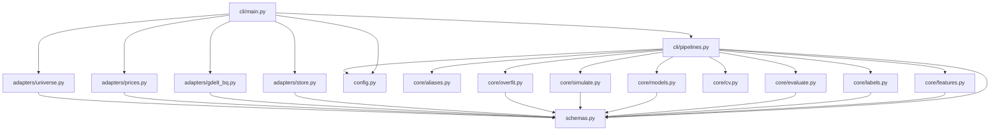
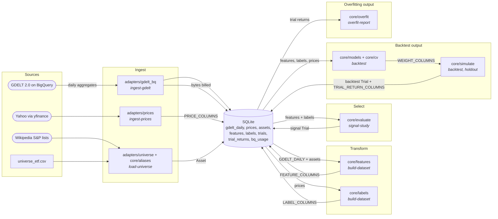

# Components — cli

## Stage view

| Output | Takes | Needs | Produces | Acted on by |
|---|---|---|---|---|
| Signal trials | every stored feature of a track x horizons 1, 5, 20 | features, labels (dev) | `trials` rows, stage `signal`, gate 1 verdict in `notes` (JSON) | the researcher choosing what to backtest; N in gate 3's DSR |
| Backtest trials | one rule feature, or one model (inputs chosen per fold on training-date IC) | features, labels, prices (dev) | `trials` row with `BacktestStats` + `trial_returns` rows | `overfit-report` |
| Overfitting report | every backtest trial of a track | trial returns | printed DSR, PBO, CI, gate 3 verdict | the researcher deciding what reaches the hold-out |
| Hold-out trial | one rule backtest trial, once | hold-out prices and GDELT, pulled by the command | `trials` row stage `holdout` + returns; gate 4 verdict | final decision / paper trading |

### cli/main.py
Composition root. Parses arguments into `Config` (home from `--home` or `EVENTTRADE_HOME`),
constructs `SqliteStore`, `GdeltBigQuery` (only for `ingest-gdelt` and a confirmed `holdout`) and
the yfinance/universe functions, then calls one pipeline.
- `main(argv: Sequence[str] | None = None) -> int` — run one subcommand and return its exit code.

### cli/pipelines.py
Declares `Store` (the SqliteStore methods it uses), `GdeltSource` (`estimate`, `pull_*`), and the
callables `FetchPrices`, `SanityCheck`, `FetchIndex`, `LoadEtfs`. Exit-code constants `OK`,
`PARTIAL`, `REFUSED`, `BUDGET`, `MISSING`.
- `status(cfg: Config, store: Store, now: Clock, echo: Echo = print) -> int` — row counts, date ranges, BigQuery spend, trial counts.
- `init_db(cfg: Config, store: Store, echo: Echo = print) -> int` — create the store.
- `load_universe(cfg: Config, store: Store, track: Track | None, load_etfs: LoadEtfs, fetch_index: FetchIndex, echo: Echo = print) -> int` — write ETFs and/or index members with GKG aliases.
- `ingest_prices(cfg: Config, store: Store, fetch: FetchPrices, tickers: list[str] | None, track: Track | None, start: date | None, end: date | None, sanity: SanityCheck | None = None, chunk: int = 100, echo: Echo = print) -> int` — dev-window daily bars.
- `ingest_gdelt(cfg: Config, store: Store, gdelt: GdeltSource, dataset: Dataset, start: date | None, end: date | None, execute: bool, by_country: bool, now: Clock, budget_error: type[Exception] = RuntimeError, echo: Echo = print) -> int` — dry run, or resumable month-by-month pull.
- `month_chunks(start: date, end: date) -> list[tuple[date, date]]` — calendar-month pieces of an inclusive window.
- `build_dataset(cfg: Config, store: Store, track: Track, echo: Echo = print) -> int` — features and labels for one track.
- `hypothesis_of(track: Track, feature: str) -> tuple[str, float]` — pre-registered hypothesis and sign of a feature name.
- `signal_study(cfg: Config, store: Store, track: Track, now: Clock, echo: Echo = print) -> int` — gate 1 over every feature x horizon, logged as trials.
- `backtest(cfg: Config, store: Store, track: Track, now: Clock, feature: str | None = None, sign: float | None = None, model: Literal["ridge", "logistic", "lgbm"] | None = None, model_features: list[str] | None = None, horizon: int = 5, rebalance: int | None = None, echo: Echo = print) -> int` — rule or walk-forward model backtest, logged with returns.
- `overfit_report(cfg: Config, store: Store, track: Track, echo: Echo = print) -> int` — gate 3.
- `holdout(cfg: Config, store: Store, track: Track, source_trial: str, confirmed: bool, gdelt: GdeltSource | None, fetch: FetchPrices, execute: bool, now: Clock, budget_error: type[Exception] = RuntimeError, echo: Echo = print) -> int` — gate 4, once per trial.
- `trial_id(stage: str, track: str, params: dict[str, Any], start: date, end: date) -> str` — deterministic trial id.

### adapters/store.py — shared
- `SqliteStore(path: Path)` — satisfies `Store` and gdelt_bq's `UsageLog`. Reads are half-open
  (`start <= date < end`); `trials`/`trial_returns` are append-only (triggers). Full method list in
  the module docstring; `gdelt_session_dates(query_name, start, end) -> list[date]` backs resumable ingest.

### adapters/gdelt_bq.py — shared
- `GdeltBigQuery(client: Any, usage: UsageLog, max_bytes_per_query: int, monthly_budget_bytes: int, now: Callable[[], datetime], lookback_days: int = 30, queries_dir: Path = QUERIES_DIR)` — satisfies `GdeltSource`; dry run, budget check, `maximum_bytes_billed`, usage log on every query.
- `session_date_of(dateadded: int, cutoff_et: str) -> date` — the cutoff rule the SQL implements.
- `partition_window(start: date, end: date, cutoff_et: str) -> tuple[date, date]` — UTC partitions a session window spans.
- `BudgetExceeded(RuntimeError)` — a query refused by the guard.

### adapters/prices.py — shared
- `fetch_yfinance(tickers: list[str], start: date, end: date, *, batch_size: int = 40, max_retries: int = 3, backoff_s: float = 2.0, download: Callable[..., pd.DataFrame] | None = None, sleep: Callable[[float], None] = time.sleep) -> pd.DataFrame` — inclusive window; raises `PriceFetchError(.failures, .prices)` on misses.
- `fetch_stooq(...)`, `cross_check(...)`, `sanity_check(prices: pd.DataFrame, *, max_gap: int = 5, max_abs_ret: float = 0.40) -> pd.DataFrame` — second source (currently blocked) and data flags.

### adapters/universe.py — shared
- `load_etf_universe() -> list[Asset]` — Track A from the packaged CSV.
- `fetch_index_members(index: Literal["sp500", "sp400"], *, get=requests.get, timeout: float = 30.0) -> list[Asset]` — current members from Wikipedia.

### core/aliases.py — shared
- `make_aliases(name: str, ticker: str) -> list[str]` — GKG-style lowercase aliases.
- `is_ambiguous(alias: str) -> bool` — aliases whose mentions are mostly not about the company.

### core/features.py — shared
- `themes_as_entities(gdelt_daily: pd.DataFrame) -> pd.DataFrame` — global theme metrics become theme entities.
- `to_trading_days(gdelt_daily: pd.DataFrame, trading_days: list[date]) -> pd.DataFrame` — roll session dates forward.
- `map_to_tickers(daily: pd.DataFrame, assets: list[Asset]) -> pd.DataFrame` — entity -> ticker on raw sums.
- `entity_features(daily: pd.DataFrame, metric_specs: list[MetricSpec], trading_days: list[date] | None = None) -> pd.DataFrame` — untransformed stats, wide.
- `surprise(series_frame: pd.DataFrame, window: int, min_periods: int, shift: int = 1, transforms: tuple[str, ...] = ("z", "lr")) -> pd.DataFrame` — z / log-ratio vs a baseline excluding t.
- `build_features(gdelt_daily: pd.DataFrame, trading_days: list[date], assets: list[Asset], specs: list[MetricSpec]) -> pd.DataFrame` — FEATURE_COLUMNS.
- `product_feature(features: pd.DataFrame, a: str, b: str, name: str) -> pd.DataFrame` — interaction a*b.
- `session_date_of(added_utc: datetime, cutoff_et: time = time(15, 30)) -> date` — reference cutoff rule.

### core/labels.py — shared
- `make_labels(prices: pd.DataFrame, horizons: list[int], trading_days: list[date] | None = None) -> pd.DataFrame` — LABEL_COLUMNS.
- `realized_vol_label(prices: pd.DataFrame, horizon: int, trading_days: list[date] | None = None, demean: bool = False) -> pd.DataFrame` — VOL_LABEL_COLUMNS (A4).

### core/evaluate.py — shared
- `evaluate_signal(feature_df, labels, feature_name: str, horizons: Sequence[int], track: Track, n_quantiles: int = 5, min_names: int = 5, nw_lags: int | None = None) -> SignalReport` — report at horizons[0].
- `daily_ic(...) -> pd.Series`, `newey_west_t(...) -> float`, `subperiod_signs(ic_series: pd.Series, n_periods: int = 3) -> list[float]`, `ic_by_return_leg(...)`, `quantile_spread(...)`, `quantile_turnover(...)`, `assign_quantiles(...)`.
- `passes_gate(report: SignalReport, subperiod_ic_means: Sequence[float], cost_bps: float) -> tuple[bool, str]` — gate 1.

### core/cv.py — shared
- `purged_splits(dates, n_folds: int, n_test_folds: int, purge: int, embargo: int) -> list[Split]` — CPCV.
- `walk_forward_splits(dates, train_days: int, test_days: int, purge: int, embargo: int, expanding: bool) -> list[Split]`.

### core/models.py — shared
- `to_design(features, labels, horizon: int, label: str = "ret_oo") -> tuple[pd.DataFrame, pd.Series]`, `standardise_cross_section(...)`, `rule_score(features_wide, feature: str, sign: float) -> pd.DataFrame`, `fit_ridge(...)`, `fit_logistic(...)`, `fit_lgbm(...)`, `predict(...)`, `oos_predictions(...)`.
- `scores_to_weights(scores, method="rank_long_short", k: int | None = None, gross: float = 1.0, max_weight: float | None = None) -> pd.DataFrame` — WEIGHT_COLUMNS.

### core/simulate.py — shared
- `simulate(weights, prices, cost_bps: float | dict[str, float], borrow_bps_annual: float, init_cash: float = 1e6) -> tuple[pd.DataFrame, BacktestStats]` — next-open execution via vectorbt. Imported lazily by pipelines (vectorbt/numba import takes ~40 s).
- `stats_from_returns(ret, turnover: float, cost_drag: float) -> BacktestStats`.

### core/overfit.py — shared
- `overfit_report(trial_returns_wide, seed: int, n_boot: int = 2000, mean_block: float = 10.0, periods_per_year: int = 252) -> OverfitReport` — gate 3 inputs.
- `deflated_sharpe(...)`, `pbo_cscv(...)`, `stationary_bootstrap_sharpe_ci(...)`, `to_wide(...)`, `sharpe(...)`, `probabilistic_sharpe(...)`, `expected_max_sharpe(...)`.
